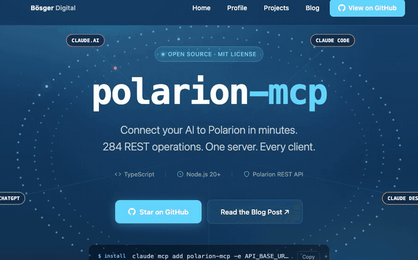

<div align="center">

# Polarion MCP

**将 Claude、VS Code Copilot 和 ChatGPT 直接连接到 Polarion ALM。**

一个开源的 **Model Context Protocol（模型上下文协议）** 服务器，将 **284 个 Polarion REST 操作** 以 AI 原生工具的形式暴露出来。

[](https://github.com/phillipboesger/polarion-mcp/actions/workflows/ci.yml)
[](https://github.com/phillipboesger/polarion-mcp/actions/workflows/docker-publish.yml)
[](LICENSE)
[](package.json)
[](tsconfig.json)
[](https://github.com/phillipboesger/polarion-mcp/pkgs/container/polarion-mcp)
[](https://modelcontextprotocol.io)

[**产品页面**](https://phillipboesger.github.io/polarion-mcp/) · [**文档**](docs/README.md) · [**Docker 镜像**](https://github.com/phillipboesger/polarion-mcp/pkgs/container/polarion-mcp)

</div>

<p align="center">
  
</p>

---

## 目录

- [功能特性](#功能特性)
- [系统要求](#系统要求)
- [快速开始](#快速开始)
  - [选择一种认证方式](#选择一种认证方式)
  - [为什么有两个 URL？](#为什么有两个-url)
  - [前置条件](#前置条件)
  - [A. 本地 stdio + PAT](#a-本地-stdio--pat)
  - [B. HTTP 服务器 + PAT 请求头](#b-http-服务器--pat-请求头)
  - [C. HTTP 服务器 + OAuth 登录](#c-http-服务器--oauth-登录)
  - [D. REST 封装 + API 密钥（ChatGPT）](#d-rest-封装--api-密钥chatgpt)
  - [E. 自定义 GPT + OAuth 登录](#e-自定义-gpt--oauth-登录)
  - [本地开发](#本地开发)
- [可用工具](#可用工具)
- [配置](#配置)
- [使用示例](#使用示例)
- [架构](#架构)
- [安全性](#安全性)
- [贡献指南](#贡献指南)
- [致谢](#致谢)
- [许可证](#许可证)

---

## 功能特性

- **严格类型校验** — 使用 Zod schema 校验所有输入，并支持 Polarion 查询语法
- **加固的错误处理** — 标准化 MCP 错误，并自动对令牌进行脱敏处理
- **分页辅助工具** — 内置实用工具，便于在结果中导航
- **安全检查** — 校验必需的环境变量，绝不记录敏感数据
- **多种传输方式** — 支持 HTTP（Streamable MCP）和 stdio
- **CI/CD 就绪** — 内置 TypeScript 检查与自动化 Docker 发布

---

## 系统要求

- Node.js v20+
- 具有只读权限的 Polarion 个人访问令牌（PAT）

---

## 快速开始

### 选择一种认证方式

每种方式最终都会归结为一个 Polarion 个人访问令牌（PAT）。它们的区别在于该令牌存放的位置，以及哪些客户端可以使用它们。

| 方式 | 令牌存放位置 | 适用场景 |
|---|---|---|
| [A. 本地 stdio + PAT](#a-本地-stdio--pat) | 存放在你机器上客户端的 MCP 配置中 | Claude Code、Claude Desktop（本地服务器）、VS Code Copilot。单用户，无需运行服务器。 |
| [B. HTTP 服务器 + PAT 请求头](#b-http-服务器--pat-请求头) | 由客户端在每次请求时发送 | Claude Code、VS Code Copilot、curl、脚本。适用于可以设置静态 `Authorization` 请求头的客户端。 |
| [C. HTTP 服务器 + OAuth 登录](#c-http-服务器--oauth-登录) | 在登录页面粘贴一次，之后由客户端加密持有 | Claude.ai、Claude Desktop 和移动端、ChatGPT 连接器（它们无法发送自定义请求头）。同样适用于 Claude Code 和 VS Code。 |
| [D. REST 封装 + API 密钥](#d-rest-封装--api-密钥chatgpt) | 服务器环境中共享的一个 PAT | ChatGPT Custom GPT Actions。所有调用方都以同一个 Polarion 用户身份操作。 |
| [E. 自定义 GPT + OAuth 登录](#e-自定义-gpt--oauth-登录) | 在登录页面粘贴一次，之后由 ChatGPT 加密持有 | ChatGPT Custom GPT Actions，每个用户使用各自的 Polarion 账户。 |

B、C 和 E 运行同一个服务器：`MCP_PUBLIC_URL` 在 B 的基础上增加了登录功能，`GPT_CLIENT_ID`/`GPT_CLIENT_SECRET` 在 C 的基础上增加了 Custom GPT 登录功能，因此一次部署即可同时服务这三种方式。

### 为什么有两个 URL？

- **`API_BASE_URL`** 是 Polarion REST API 所在地址，例如 `https://polarion.example.com/polarion/rest/v1`（始终以 `/polarion/rest/v1` 结尾）。服务器会*调用*该地址。每种方式都需要用到它。
- **`MCP_PUBLIC_URL`** 是这台服务器自身的公网地址，即客户端所看到的地址，例如 `https://mcp.example.com`（仅为主机名，不含路径）。只有方式 C 需要它。在 TLS 代理后面，进程只能看到 `http://127.0.0.1:3000`，但它发布的 OAuth 元数据必须包含客户端能够访问到的绝对 HTTPS URL（issuer、`/authorize`、`/token`、`/register`）。服务器不会根据请求的 `Host` 请求头来推断这个地址，因为伪造的请求头会改变 issuer。

客户端永远不需要 `API_BASE_URL`。对于 B 和 C，它只需要连接器地址：即服务器公网主机名加上 `/mcp`。

### 前置条件

- 启用 REST API 的 Polarion（在 `polarion.properties` 中设置 `com.siemens.polarion.rest.enabled=true`）。
- 每个用户一个 Polarion PAT：在 Polarion 中，通过 *My Account > Personal Access Tokens*（我的账户 > 个人访问令牌）获取。该令牌带有用户自己的权限。
- Node.js 20+ **或** Docker。从源码构建：

  ```bash
  git clone https://github.com/phillipboesger/polarion-mcp.git
  cd polarion-mcp
  npm ci            # 也会执行构建
  ```

### A. 本地 stdio + PAT

客户端将服务器作为子进程启动；不会监听任何网络端口。

1. 从源码构建（见前置条件）或拉取镜像：
   `docker pull ghcr.io/phillipboesger/polarion-mcp:latest`。
2. 在客户端中注册它：

   **Claude Code**

   ```bash
   claude mcp add polarion \
     -e API_BASE_URL=https://polarion.example.com/polarion/rest/v1 \
     -e BEARER_TOKEN=<your-polarion-pat> \
     -- node /absolute/path/to/polarion-mcp/build/index.js
   ```

   **Claude Desktop**（`claude_desktop_config.json`，然后重启应用）

   ```json
   {
     "mcpServers": {
       "polarion": {
         "command": "node",
         "args": ["/absolute/path/to/polarion-mcp/build/index.js"],
         "env": {
           "API_BASE_URL": "https://polarion.example.com/polarion/rest/v1",
           "BEARER_TOKEN": "<your-polarion-pat>"
         }
       }
     }
   }
   ```

   **VS Code Copilot**（`.vscode/mcp.json`；VS Code 会提示输入令牌并将其安全存储）

   ```json
   {
     "inputs": [
       { "type": "promptString", "id": "polarion-pat", "description": "Polarion PAT", "password": true }
     ],
     "servers": {
       "polarion": {
         "type": "stdio",
         "command": "node",
         "args": ["/absolute/path/to/polarion-mcp/build/index.js"],
         "env": {
           "API_BASE_URL": "https://polarion.example.com/polarion/rest/v1",
           "BEARER_TOKEN": "${input:polarion-pat}"
         }
       }
     }
   }
   ```

   **用 Docker 代替 Node**，将以上任意命令中的启动命令替换为：

   ```bash
   docker run --rm -i \
     -e API_BASE_URL=https://polarion.example.com/polarion/rest/v1 \
     -e BEARER_TOKEN=<your-polarion-pat> \
     ghcr.io/phillipboesger/polarion-mcp:latest \
     node build/index.js
   ```

3. 验证：在 Claude Code 中运行 `/mcp`（服务器显示 *connected* 已连接），然后询问
   "list my Polarion projects"（列出我的 Polarion 项目）。

### B. HTTP 服务器 + PAT 请求头

一台共享服务器，**不**保存任何凭据；每个客户端发送自己的 PAT。

**服务器**

1. 启动它。该镜像默认运行 Streamable HTTP MCP 服务器：

   ```bash
   docker run -d --name polarion-mcp \
     -e API_BASE_URL=https://polarion.example.com/polarion/rest/v1 \
     -e MCP_ALLOWED_HOSTS=mcp.example.com \
     -p 127.0.0.1:3000:3000 \
     ghcr.io/phillipboesger/polarion-mcp:latest
   ```

   从源码运行：`MCP_HTTP_HOST=127.0.0.1 API_BASE_URL=... npm run start:mcp-http`。
2. 在其前面配置 TLS（反向代理将 `/mcp` 转发到 `127.0.0.1:3000`）。PAT 通过请求头传输，因此切勿暴露明文端口。对于 Polarion 服务器自带的 Apache，参见 [docs/deployment.md](docs/deployment.md)。
3. 验证：

   ```bash
   curl -s https://mcp.example.com/health
   curl -si -X POST https://mcp.example.com/mcp \
     -H 'authorization: Bearer <your-polarion-pat>' \
     -H 'content-type: application/json' \
     -H 'accept: application/json, text/event-stream' \
     -d '{"jsonrpc":"2.0","id":1,"method":"initialize","params":{"protocolVersion":"2025-06-18","capabilities":{},"clientInfo":{"name":"curl","version":"1"}}}' \
     | head -1        # HTTP/1.1 200
   ```

**客户端**

- **Claude Code**

  ```bash
  claude mcp add --transport http polarion https://mcp.example.com/mcp \
    --header "Authorization: Bearer <your-polarion-pat>"
  ```

- **VS Code Copilot**（`.vscode/mcp.json`）

  ```json
  {
    "inputs": [
      { "type": "promptString", "id": "polarion-pat", "description": "Polarion PAT", "password": true }
    ],
    "servers": {
      "polarion": {
        "type": "http",
        "url": "https://mcp.example.com/mcp",
        "headers": { "Authorization": "Bearer ${input:polarion-pat}" }
      }
    }
  }
  ```

- **你自己的代码**：参见 [使用示例](#使用示例)。

Claude.ai 和 Claude Desktop 连接器无法设置请求头；请为它们使用方式 C。

### C. HTTP 服务器 + OAuth 登录

与 B 相同的服务器，外加 `MCP_PUBLIC_URL`。未携带令牌的客户端连接时会收到一个指向登录页面的 `401`；用户粘贴一次自己的 PAT，服务器会向 Polarion 校验它，然后向客户端颁发令牌，这些令牌携带的 PAT 在 `MCP_TOKEN_SECRET` 下加密。服务器不存储任何内容；只有它能读取这些令牌。

**服务器**

1. 选择一个公网 HTTPS 主机名。它必须**能从客户端连接的位置**访问：Claude.ai 以及 Claude Desktop/移动端连接器是从 Anthropic 的云端连接的，因此该主机必须能从互联网访问（仅 VPN 或内网的主机无法工作）。Claude Code 和 VS Code 是从你自己的机器连接的，因此内网主机对它们来说没问题。
2. 启动它：

   ```bash
   docker run -d --name polarion-mcp \
     -e API_BASE_URL=https://polarion.example.com/polarion/rest/v1 \
     -e MCP_PUBLIC_URL=https://mcp.example.com \
     -e MCP_TOKEN_SECRET=$(openssl rand -base64 48) \
     -e MCP_ALLOWED_HOSTS=mcp.example.com \
     -p 127.0.0.1:3000:3000 \
     ghcr.io/phillipboesger/polarion-mcp:latest
   ```

   日志中必须显示 `OAuth login enabled at https://mcp.example.com/authorize`。
   请将 `MCP_TOKEN_SECRET` 像密码一样保管并保持固定不变：正是它让登录在重启和重新部署后依然有效（并且在负载均衡器后面的每个实例上都必须相同）。更改它会注销所有人。
3. 配置 TLS 反向代理转发**所有**以下路径，否则登录会在中途中断：`/mcp`、`/authorize`、`/token`、`/register`、`/polarion-login`、`/.well-known/oauth-authorization-server`、`/.well-known/oauth-protected-resource`（前缀匹配），方式 E 还需要 `/gpt/` 和 `/api/tools` 以及 `/openapi-gpt.json`。使用一个专门转发 `/` 全部内容的主机名最简单。这些路径位于根路径下，因此服务器不能放在诸如 `https://host/polarion-mcp` 这样的子路径下。
   Polarion 主机的 Apache 配置块：[docs/deployment.md](docs/deployment.md)。
4. 验证：

   ```bash
   # 返回 401 并带有 WWW-Authenticate 请求头：这正是让客户端提供登录页面的机制
   curl -si -X POST https://mcp.example.com/mcp \
     -H 'content-type: application/json' \
     -H 'accept: application/json, text/event-stream' \
     -d '{"jsonrpc":"2.0","id":1,"method":"initialize","params":{}}' | grep -i www-authenticate
   curl -s https://mcp.example.com/.well-known/oauth-protected-resource/mcp
   curl -s https://mcp.example.com/.well-known/oauth-authorization-server
   ```

   这两个 JSON 文档中的每个 URL 都必须以 `https://mcp.example.com` 开头。

**客户端**

- **Claude.ai**（也会同步到 Claude Desktop 和移动端）：*Settings > Connectors > Add custom connector*（设置 > 连接器 > 添加自定义连接器），命名它，URL 填 `https://mcp.example.com/mcp`，*OAuth Client ID/Secret* 留空（客户端会自行注册）。点击 *Connect*（连接），在打开的页面上粘贴你的 PAT，再次点击 *Connect*。在 Team/Enterprise 套餐中，可能先要由管理员为组织添加该连接器。
- **Claude Code**：`claude mcp add --transport http polarion https://mcp.example.com/mcp`，
  然后运行 `/mcp`，选择 `polarion`，点击 *Authenticate*（认证）；登录页面会在你的浏览器中打开。
- **ChatGPT**（Plus/Pro/Business/Enterprise）：*Settings > Security and login*（设置 > 安全与登录），打开 *Developer mode*（开发者模式）（在 Business/Enterprise 上，可能要先由管理员允许自定义连接器）。然后添加一个自定义连接器/应用，URL 填 `https://mcp.example.com/mcp`，认证方式选择 *OAuth*；client ID 和 secret 留空，ChatGPT 会自行注册。在打开的页面上粘贴你的 PAT。
- **VS Code Copilot**：像 B 中那样添加服务器，但不填 `headers`；VS Code 会在首次使用时要求你进行身份认证。

**一次登录持续多久：** 只要 Polarion 仍接受该 PAT 就有效。客户端每小时静默续期一次访问令牌；每次续期都会向 Polarion 重新校验该 PAT，因此撤销 PAT（或其到期日已过）会在下一次续期时终止登录，并提示用户重新登录。只要 `MCP_TOKEN_SECRET` 保持不变，服务器重启不会注销任何人。没有按会话的注销机制：要切断某个用户，在 Polarion 中撤销其 PAT；要切断所有人，更改 `MCP_TOKEN_SECRET`。

### D. REST 封装 + API 密钥（ChatGPT）

为 Custom GPT Actions 提供的一个普通 REST 接口，不是 MCP。它对所有调用方使用**同一个** PAT；没有按用户的登录。

1. 启动它：

   ```bash
   docker run -d --name polarion-rest \
     -e API_BASE_URL=https://polarion.example.com/polarion/rest/v1 \
     -e BEARER_TOKEN=<service-account-pat> \
     -e HTTP_API_KEY=$(openssl rand -hex 32) \
     -p 127.0.0.1:3000:3000 \
     ghcr.io/phillipboesger/polarion-mcp:latest \
     node build/http-server.js
   ```

2. 通过 HTTPS 发布它（反向代理），然后检查 `curl -s https://gpt.example.com/health`。
3. 在 GPT 编辑器中：*Configure > Actions > Create new action > Import from URL*（配置 > 操作 > 创建新操作 > 从 URL 导入）`https://gpt.example.com/openapi-gpt.json`（包含符合 ChatGPT 上限的 30 个工具子集）。*Authentication*（认证）选择 API Key，Auth Type（认证类型）为 *Bearer*，粘贴 `HTTP_API_KEY` 的值。

### E. 自定义 GPT + OAuth 登录

Custom GPT Action 会用每个用户自己的 PAT 登录，就像 C 一样。它运行在 C 服务器上；Actions 无法像连接器那样执行自动客户端注册或 PKCE，因此 GPT 会获得一个固定的 client id 和 secret，以及它自己的两个端点。

**服务器**

1. 设置好 C，包括 `MCP_TOKEN_SECRET`。该主机必须能从互联网访问（ChatGPT 会从 OpenAI 的云端调用它）。
2. 为 GPT 添加一个 client id 和 secret 并重启：

   ```bash
   -e GPT_CLIENT_ID=polarion-gpt \
   -e GPT_CLIENT_SECRET=$(openssl rand -hex 32)
   ```

   日志中必须显示 `Custom GPT OAuth enabled: authorize https://mcp.example.com/gpt/authorize, ...`。
3. 在反向代理中同样转发 `/gpt/`、`/api/tools` 和 `/openapi-gpt.json`（见 C 步骤 3）。

**GPT 编辑器**

1. *Configure > Actions > Create new action > Import from URL*（配置 > 操作 > 创建新操作 > 从 URL 导入）`https://mcp.example.com/openapi-gpt.json`。
2. *Authentication > OAuth*（认证 > OAuth）：

   | 字段 | 值 |
   |---|---|
   | Client ID | `GPT_CLIENT_ID` 的值 |
   | Client Secret | `GPT_CLIENT_SECRET` 的值 |
   | Authorization URL | `https://mcp.example.com/gpt/authorize` |
   | Token URL | `https://mcp.example.com/gpt/token` |
   | Scope | `polarion` |
   | Token Exchange Method | Default (POST request) 或 Basic authorization header；两者均可 |

3. 保存。服务器只接受 ChatGPT 自己的回调地址（`https://chatgpt.com/aip/<gpt-id>/oauth/callback`），因此无需配置白名单。
4. 测试：在 GPT 预览中询问 "list my Polarion projects"（列出我的 Polarion 项目），点击 *Sign in with mcp.example.com*（使用 mcp.example.com 登录），粘贴你的 PAT。之后的调用会静默运行，直到该 PAT 被撤销或过期。

### 本地开发

```bash
npm ci
cp .env.example .env   # 设置 API_BASE_URL；BEARER_TOKEN 仅用于 stdio / REST 模式
npm run build
npm run start:mcp-http # 在 :3000 上启动 Streamable HTTP MCP 服务器
```

参见 `docs/examples.http` 获取可运行的 HTTP 请求示例，以及 `docs/client-example.ts` 获取完整的 Node.js 客户端示例。

---

## 可用工具

根据 Polarion OpenAPI 规范生成了 284 个工具。下面是一些代表性示例：

| 工具 | 描述 |
|---|---|
| `getAllWorkItems` | 列出某个项目中的工作项 |
| `getWorkItem` | 按 ID 获取某个工作项 |
| `getAllDocuments` | 列出某个项目中的文档 |
| `getDocument` | 获取某个文档 |
| `postWorkItems` | 创建新的工作项 |
| `patchWorkItem` | 更新一个已有的工作项 |

所有工具都接受一个可选的 `rawPath` 参数，可在不修改代码的情况下覆盖 REST 端点路径——当你的 Polarion 版本使用非标准路径时非常有用。

完整列表由 `src/tools.ts` 通过 `npm run generate-tools` 生成。

---

## 配置

### 环境变量

```bash
# 必需
API_BASE_URL=https://your-polarion.com/polarion/rest/v1

# 仅 stdio 和 REST（ChatGPT）模式需要。MCP HTTP 服务器会忽略它：
# 每个客户端发送自己的 PAT
BEARER_TOKEN=your_polarion_personal_access_token

# 可选
MCP_HTTP_PORT=3000                     # MCP HTTP 服务器的端口（默认 3000）
MCP_HTTP_HOST=127.0.0.1                # 绑定地址（默认 0.0.0.0）；在 TLS 代理后使用回环地址
MCP_PUBLIC_URL=https://mcp.example.com # 公网 HTTPS 主机名（不含路径）；启用 OAuth 登录页面
MCP_ALLOWED_HOSTS=your-host.com        # DNS 重绑定保护（逗号分隔）
MCP_TOKEN_SECRET=...                   # 至少 32 个字符；使 OAuth 登录在重启后仍然有效（保持固定）
GPT_CLIENT_ID=polarion-gpt             # Custom GPT OAuth 客户端（方式 E），与 GPT_CLIENT_SECRET 搭配使用
GPT_CLIENT_SECRET=...
NODE_TLS_REJECT_UNAUTHORIZED=0         # 为自签名证书禁用 SSL 校验
```

---

## 使用示例

### Node.js 客户端

```typescript
import { Client } from "@modelcontextprotocol/sdk/client/index.js";
import { StreamableHTTPClientTransport } from "@modelcontextprotocol/sdk/client/streamableHttp.js";

const client = new Client({ name: "my-client", version: "1.0.0" });
await client.connect(
  new StreamableHTTPClientTransport(new URL("http://localhost:3000/mcp"), {
    requestInit: { headers: { Authorization: "Bearer your_polarion_pat" } },
  })
);

const result = await client.callTool({
  name: "getAllWorkItems",
  arguments: { projectId: "MYPROJECT", query: "status:open", pageSize: 10 },
});
```

### 分页

所有列表操作都支持 `pageSize` 和 `pageStartIndex` 参数：

```typescript
const page1 = await client.callTool({
  name: "getAllWorkItems",
  arguments: { projectId: "MYPROJECT", query: "status:open", pageSize: 50, pageStartIndex: 0 },
});
```

---

## 架构

```
src/
  config.ts           — API 基础 URL、令牌和资源 URL 常量
  server.ts           — 共享的 MCP 服务器工厂（与传输方式无关）
  tools.ts            — 生成的 MCP 工具定义（284 个工具）
  executor.ts         — 工具调用分发器
  mcp-http-server.ts  — Streamable HTTP MCP 传输（远程客户端）
  http-server.ts      — 面向 ChatGPT Custom GPT Actions 的普通 REST 封装
  index.ts            — stdio 入口点（本地 MCP 客户端）
  polarion.ts         — 资源和提示处理器
  auth.ts             — 身份认证辅助工具
  utils.ts            — 共享工具函数
```

**设计说明：**

- 工具通过 `npm run regenerate` 从 Polarion OpenAPI 规范自动生成。
- 不同版本的 Polarion 的 REST 路径可能不同。每个工具都支持 `rawPath`，可在不修改代码的情况下覆盖端点。
- 按设计不进行缓存。仅在遇到 429/5xx 时以较短的退避时间重试。
- Bearer 令牌会自动从所有日志和错误消息中脱敏。

---

## 安全性

- **HTTP 模式下不存储任何凭据** — 服务器自身不保存任何 Polarion 令牌；每个 `/mcp` 请求要么携带调用者自己的 Polarion PAT，要么携带来自 OAuth 登录的访问令牌（该令牌携带的 PAT 在 `MCP_TOKEN_SECRET` 下加密，客户端无法读取），Polarion 会以该用户身份对每次调用进行授权
- **通过 TLS 提供服务** — PAT 通过请求头传输；请在服务器前面终结 TLS，并将明文端口绑定到回环地址（`MCP_HTTP_HOST=127.0.0.1`）
- **DNS 重绑定保护** — 可选的 `MCP_ALLOWED_HOSTS` 白名单会在每次请求时校验 `Host` 请求头
- **日志中无机密** — 令牌会自动从所有日志输出和错误消息中移除

---

## 贡献指南

欢迎贡献。要开始：

```bash
npm install
npm run typecheck      # TypeScript 检查
npm run build          # 编译到 build/
npm run dev:http       # 本地运行
```

要从最新的 Polarion OpenAPI 规范重新生成工具：

```bash
npm run regenerate     # 下载规范、生成工具、构建并测试
```

在提交较大的改动之前，请先提出一个 issue，以便我们讨论方案。Pull request 应包含改动内容及其原因的说明。

### 发布

发布由 [`.github/workflows/release.yml`](.github/workflows/release.yml) 自动化完成：

1. 在 `package.json` 中提升 `"version"`，并提交到 `main` 分支。
2. 为提交打上标签并推送：`git tag vX.Y.Z && git push origin vX.Y.Z`。
3. 该工作流会构建、测试并打包发布 ZIP，然后为这个标签发布一个 GitHub Release，发布说明会根据自上一个标签以来合并的 pull request 自动生成（首次发布则从历史记录的开头开始生成）。

---

## 致谢

🙏 感谢 [@Jonasdero](https://github.com/Jonasdero)，他的工作是这个 MCP 服务器所基于的基础。

---

## 许可证

[MIT](LICENSE) © Phillip Bösger
